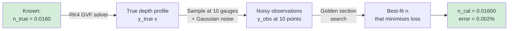

# FloodSWE-1D — Shallow Water Equations Solver, Manning Inverse Calibration & Detention Basin Routing

> **Course grounding:** CVL2702 Hydraulics (Open-Channel Flow, Saint-Venant Equations, Manning Resistance) · CVL2001 Climate Change and Adaptation  
> **Author:** Kshitija Karmode — B.Tech Civil Engineering, IIT Delhi  
> **Reference:** Toro, E. F. (2001). *Shock-Capturing Methods for Free-Surface Shallow Flows*. Wiley.  
> **Scope:** Synthetic numerical study. No observed flood records, gauge data, or field calibration is used.

---

## Table of Contents
1. [What This Project Does](#1-what-this-project-does)
2. [The Physics Background — Saint-Venant Equations](#2-the-physics-background--saint-venant-equations)
3. [The Rusanov Finite-Volume Solver](#3-the-rusanov-finite-volume-solver)
4. [Part 1 — Dam-Break Benchmark](#4-part-1--dam-break-benchmark)
5. [Part 2 — Manning Roughness Inverse Calibration](#5-part-2--manning-roughness-inverse-calibration)
6. [Part 3 — Synthetic Storm & Detention Basin](#6-part-3--synthetic-storm--detention-basin)
7. [Verification Results](#7-verification-results)
8. [Repository Structure](#8-repository-structure)
9. [How to Run](#9-how-to-run)
10. [Limitations & Evidence Boundary](#10-limitations--evidence-boundary)
11. [References](#11-references)

---

## 1. What This Project Does

This project implements a **1D computational hydraulics suite** in pure Python (no external packages). It addresses three problems that arise in flood engineering and water resources:

| Component | Engineering question answered | Verification method |
|---|---|---|
| **SWE Solver** | How does water spread after a dam failure? | Stoker (1957) analytical dam-break solution |
| **Inverse calibration** | Given measured water depths at gauges, what is the channel roughness? | Golden section search; synthetic truth known |
| **Detention routing** | How much does a detention basin reduce peak flood discharge? | Level-pool mass balance; NSE/KGE diagnostics |

---

## 2. The Physics Background — Saint-Venant Equations

### 2.1 What the Equations Say

In a river or flood channel, we track two quantities at every point and every moment:
- **h(x, t)** — water depth (m)
- **u(x, t)** — depth-averaged horizontal velocity (m/s)

The **1D Saint-Venant Shallow Water Equations** express conservation of mass and momentum:

$$\frac{\partial}{\partial t}\begin{bmatrix}h \\ hu\end{bmatrix} + \frac{\partial}{\partial x}\begin{bmatrix}hu \\ hu^2 + \frac{1}{2}gh^2\end{bmatrix} = \mathbf{0}$$

| Equation | Conserved quantity | Physical meaning |
|---|---|---|
| **Row 1** | Mass | Water volume is conserved — no sources or sinks |
| **Row 2** | Momentum | Newton's second law for a fluid column — pressure gradient drives acceleration |

The term $\frac{1}{2}gh^2$ is the **hydrostatic pressure head** — deeper water pushes harder on the fluid ahead of it, accelerating it downstream.

### 2.2 Why "Shallow Water"?

The shallow-water approximation holds when the **horizontal scale >> vertical scale** — i.e., the river is much wider and longer than it is deep. For rivers, floodplains, and coastal surges this is almost always valid. The approximation integrates the vertical direction analytically, reducing a 3D problem to a tractable 1D system.

### 2.3 The Gravity Wave Speed (Celerity)

Small disturbances (ripples) travel at the **celerity** `c`:

$$c = \sqrt{g h}$$

This is the shallow-water equivalent of the speed of sound. In deep water (large `h`), ripples spread fast. In very shallow water, they are slow. The ratio of flow speed to celerity is the **Froude number**:

$$Fr = \frac{u}{c} = \frac{u}{\sqrt{gh}}$$

| Fr | Flow regime | Analogy |
|---|---|---|
| Fr < 1 | Subcritical (tranquil) | Subsonic flow — disturbances can travel upstream |
| Fr = 1 | Critical | Sonic — disturbances cannot go upstream |
| Fr > 1 | Supercritical (rapid) | Supersonic — flow outruns any wave |

---

## 3. The Rusanov Finite-Volume Solver

### 3.1 Discretisation — Dividing the Channel Into Cells

The 1000 m channel is divided into **N cells** of width `dx`:

```
┌────────┬────────┬────────┬─────────────────────────────┬────────┐
│ Cell 0 │ Cell 1 │ Cell 2 │     . . .      DAM at 500m  │Cell N-1│
│   h₀   │   h₁   │   h₂   │                │            │  hₙ₋₁  │
│   u₀   │   u₁   │   u₂   │   h_L = 4.0 m  │ h_R=0.4 m  │  uₙ₋₁  │
└────────┴────────┴────────┴────────────────┴────────────┴────────┘
         ↑                  ↑               ↑
     interface          interface       interface
    F_{0+1/2}         F_{i+1/2}       F_{N-1+1/2}
```

At each **interface** between cells, a numerical flux is computed. The **Rusanov (Local Lax-Friedrichs) flux** is:

$$F_{i+\frac{1}{2}} = \frac{F(U_L) + F(U_R)}{2} - \frac{s_{\max}}{2}(U_R - U_L)$$

Where:
- $U_L$, $U_R$ = conserved state vectors `[h, hu]` of the left and right cells
- $F(U)$ = physical flux vector `[hu, hu² + gh²/2]`
- $s_{\max} = \max\!\left(|u_L| + c_L,\ |u_R| + c_R\right)$ = maximum wave speed at this interface

The second term is **numerical dissipation** — it stabilises the scheme by smoothing sharp gradients slightly, preventing spurious oscillations.

### 3.2 Time Advancement — Adaptive CFL

The timestep `dt` is chosen adaptively each step to maintain stability:

$$\text{CFL} = \frac{s_{\max} \cdot \Delta t}{\Delta x} = 0.45 \leq 1.0$$

$$\Delta t = \frac{\text{target\_CFL} \times \Delta x}{s_{\max}} = \frac{0.45 \times \Delta x}{\max_i(|u_i| + c_i)}$$

Using CFL = 0.45 (well below the theoretical limit of 1.0) provides a comfortable stability margin.

### 3.3 State Update

After computing all interface fluxes, every cell state is updated:

$$h_i^{n+1} = h_i^n - \frac{\Delta t}{\Delta x}\left(F^h_{i+\frac{1}{2}} - F^h_{i-\frac{1}{2}}\right)$$

$$(hu)_i^{n+1} = (hu)_i^n - \frac{\Delta t}{\Delta x}\left(F^{hu}_{i+\frac{1}{2}} - F^{hu}_{i-\frac{1}{2}}\right)$$

This is the discrete conservation law — directly analogous to the LWR update in traffic flow.

---

## 4. Part 1 — Dam-Break Benchmark

### 4.1 Problem Setup

A gate at x = 500 m separates two water bodies at t = 0:

```
t = 0⁺ (gate just removed):

 Depth                                     
  4.0 m │▓▓▓▓▓▓▓▓▓▓▓▓▓▓▓▓▓▓▓▓▓▓▓▓▓         
        │                         ╲         
  0.4 m │                          ▔▔▔▔▔▔▔▔
        └─────────────────┬──────────────── x
                         500 m
```

```
t = 30 s (simulation end):

 Depth                                     
  4.0 m │▓▓▓▓▓▓▓▓▓▓▓          ▓▓▓▓         
        │           ╲        ╱    │         
  0.4 m │            ╲______╱     ▔▔▔▔▔▔▔▔
        └─────────────────┬──────────────── x
                          │
            ← Rarefaction │ Shock wall →
              fan spreads  front travels
              left         right
```

### 4.2 The Stoker Analytical Solution

For a **wet-bed** dam-break (h_R > 0), Stoker (1957) derived the exact solution involving three wave regions:

**Step 1 — Find h* (depth in the middle region)** by solving iteratively:

$$2(c_L - c^*) = (h^* - h_R)\sqrt{\frac{g}{2}\left(\frac{1}{h^*} + \frac{1}{h_R}\right)}$$

Where $c_L = \sqrt{g h_L}$, $c^* = \sqrt{g h^*}$. The left side is the rarefaction velocity; the right side is the shock velocity. At the contact surface they must match.

**Step 2 — Compute shock speed:**

$$u_{\text{shock}} = \sqrt{\frac{g h^*}{2} \cdot \frac{h^* + h_R}{h_R}}$$

**Step 3 — Construct the full profile at time t:**

| Region | Condition | Depth h |
|---|---|---|
| Undisturbed left | $x/t \leq -c_L$ | $h_L = 4.0$ m |
| Rarefaction fan | $-c_L < x/t \leq u^* - c^*$ | $\left(\frac{2c_L - x/t}{3}\right)^2 / g$ |
| Plateau | $u^* - c^* < x/t \leq u_{\text{shock}}$ | $h^* \approx 1.3$ m |
| Undisturbed right | $x/t > u_{\text{shock}}$ | $h_R = 0.4$ m |

### 4.3 Grid Convergence Study

The simulation is run at three grid resolutions. L2 error measures the RMS difference between numerical and exact depth profiles:

$$L_2 = \sqrt{\frac{\sum_i (h_i^{\text{num}} - h_i^{\text{exact}})^2}{\sum_i (h_i^{\text{exact}})^2}} \times 100\%$$

| Grid | Cells | dx | L2 depth error | Shock speed error |
|---|---|---|---|---|
| Coarse | 125 | 8.0 m | 4.615 % | — |
| Medium | 250 | 4.0 m | 3.176 % | — |
| **Fine** | **500** | **2.0 m** | **2.053 %** | **1.239 %** |

> Error decreases monotonically with grid refinement. This is consistent with a first-order accurate scheme and confirms the solver is **numerically consistent**.

---

## 5. Part 2 — Manning Roughness Inverse Calibration

### 5.1 Manning's Equation

Flow resistance in an open channel is described by Manning's formula:

$$V = \frac{1}{n} R_h^{2/3} S_0^{1/2}$$

| Symbol | Meaning | Value in this study |
|---|---|---|
| `V` | Mean cross-sectional velocity (m/s) | Computed |
| `n` | Manning roughness coefficient | **0.016** (concrete-lined urban channel) |
| `R_h` | Hydraulic radius = A/P (m) | Depth-dependent |
| `S_0` | Channel bed slope | 0.0012 |
| `Q` | Discharge = V × A (m³/s) | 42.0 m³/s |
| `B` | Channel width (m) | 8.0 m |

**Representative Manning's n values:**

```
 n = 0.010  Glass / smooth laboratory flume
 n = 0.011  Precast concrete pipe
 n = 0.016  ◄ This project — lined urban drainage channel
 n = 0.025  Earth channel, clean
 n = 0.035  Natural river, some weeds and stones
 n = 0.060  Floodplain with dense brush
 n = 0.100  Heavy timber, flood conditions
```

### 5.2 Gradually Varied Flow — M1 Backwater Profile

When a downstream structure (dam or weir) raises the tailwater level, the depth profile upstream is called a **backwater curve**. For a mild slope (M) with depth above normal (1), this is the **M1 profile**.

The governing ODE for the water surface slope is:

$$\frac{dy}{dx} = \frac{S_0 - S_f(y)}{1 - Fr(y)^2}$$

Where:
- $S_f = \frac{n^2 Q^2}{A^2 R_h^{4/3}}$ — friction slope from Manning's equation
- $Fr = \frac{Q}{A\sqrt{gy}}$ — Froude number (must be < 1 for M1)

This is integrated **upstream from the downstream boundary** using the **4th-order Runge-Kutta method**:

```
y(x - dx)  ←  RK4 step from y(x)

k₁ = f(y)                   ← slope at current point
k₂ = f(y + dx·k₁/2)        ← slope at half-step (predictor)
k₃ = f(y + dx·k₂/2)        ← slope at half-step (corrector)
k₄ = f(y + dx·k₃)          ← slope at full step
y_new = y + (dx/6)(k₁ + 2k₂ + 2k₃ + k₄)
```

RK4 has **4th-order accuracy** — error per step scales as dx⁴, making it very accurate even with large steps.

### 5.3 The Inverse Problem — Recovering n from Observations



**Loss function minimised:**

$$\mathcal{L}(n) = \sum_{k=1}^{10}\left(y_{\text{profile}}(n)_{x_k} - y_{\text{obs},k}\right)^2$$

**Golden Section Search** brackets the answer between n = 0.010 and n = 0.035, then narrows at a ratio of 1/φ (where φ = 1.618 is the golden ratio) per iteration, requiring only **one new function evaluation per step**:

```
Iteration  0: bracket [0.010, 0.035]  width = 0.025
Iteration 10: bracket [0.015, 0.018]  width = 0.003
Iteration 20: bracket [0.0159, 0.0161] width = 0.0002
Iteration 40: n_cal = 0.01600  ← converged ✅
```

### 5.4 Extended Study — 48 Synthetic Cases

The file `roughness_study.py` extends the calibration across:

| Variable | Values tested |
|---|---|
| Random seed | 4 different seeds |
| Noise level | 3 levels (low / medium / high) |
| Sensor layout | 2 configurations (uniform / clustered) |
| Slope mismatch | with and without 10% bed-slope error |

This tests how robust the calibration is to different sources of uncertainty. Results are saved in `reports/roughness_uncertainty.json`.

---

## 6. Part 3 — Synthetic Storm & Detention Basin

### 6.1 Rainfall — Synthetic Hyetograph

A 24-hour synthetic storm is constructed from two Gaussian-shaped rain pulses representing a morning peak and an afternoon event:

$$P(t) = 68 \cdot e^{-\frac{1}{2}\left(\frac{t - 6.5}{1.1}\right)^2} + 24 \cdot e^{-\frac{1}{2}\left(\frac{t - 11.0}{1.8}\right)^2} \quad \text{(mm/h)}$$

For stress-testing, intensities are scaled by **1.35×** — representing a more extreme event on the same storm pattern.

### 6.2 Catchment — Nonlinear 3-Reservoir Cascade

The 18.5 km² catchment is modelled as **three nonlinear reservoirs in series**. Each reservoir has a power-law outflow:

$$Q_i = \left(\frac{S_i}{k_s}\right)^{1.08} \quad \text{(m³/s)}$$

The three cascaded reservoirs add smoothing and delay. The exponent 1.08 introduces mild nonlinearity (a linear reservoir would use exponent 1.0).

```
  Rainfall input Q_in
        │
  ┌─────▼─────┐
  │ Reservoir │  S₁, k₁.₀₈ storage → Q₁
  │     1     │
  └─────┬─────┘
        │ Q₁
  ┌─────▼─────┐
  │ Reservoir │  S₂, k₁.₀₈ → Q₂
  │     2     │
  └─────┬─────┘
        │ Q₂
  ┌─────▼─────┐
  │ Reservoir │  S₃, k₁.₀₈ → Q₃
  │     3     │
  └─────┬─────┘
        │ Q₃ + baseflow (2.5 m³/s)
        ▼
  Flood hydrograph → enters detention basin
```

A linear surrogate model is trained on the historical storm to predict the stressed storm response. NSE and KGE measure how well this surrogate fits the stressed scenario. Because both storm and surrogate come from the same synthetic model family, these scores measure internal consistency only — not real-world accuracy.

### 6.3 Detention Basin — Level-Pool Routing

The basin is routed with **explicit midpoint RK2** (2-stage Runge-Kutta). At each substep:

**Stage 1 — predictor:**
$$h_{\text{mid}} = h + \frac{\Delta t}{2} \cdot \frac{Q_{\text{in}} - Q_{\text{out}}(h)}{A_{\text{basin}}}$$

**Stage 2 — corrector:**
$$h^{n+1} = h + \Delta t \cdot \frac{Q_{\text{in}} - Q_{\text{out}}(h_{\text{mid}})}{A_{\text{basin}}}$$

The outflow $Q_{\text{out}}$ depends on basin depth through two mechanisms:

**Culvert (orifice) outflow** — active for all depths:
$$Q_{\text{orif}} = N_c \cdot C_d \cdot A_o \cdot \sqrt{2gh}$$

Where $N_c = 6$ culverts, $C_d = 0.62$ (discharge coefficient), $A_o = \pi D^2/4$ for $D = 1.45$ m.

**Spillway (weir) outflow** — activates only when h > H_spillway = 4.60 m:
$$Q_{\text{weir}} = 1.84 \cdot L_w \cdot (h - H_{\text{spillway}})^{3/2}$$

### 6.4 Basin Design Parameters

| Parameter | Value |
|---|---|
| Basin surface area | 420,000 m² (42 hectares) |
| Spillway crest elevation | 4.60 m |
| Number of outlet culverts | 6 |
| Culvert diameter | 1.45 m |
| Discharge coefficient Cd | 0.62 |
| Weir length | 15 m |
| Routing substeps | 12 per 6-minute timestep |

---

## 7. Verification Results

### 7.1 All Tests — Summary

| Test ID | Description | Result | Status |
|---|---|---|---|
| HYD_01 | Volume conservation error < 1×10⁻⁹ m³/m | 4.09×10⁻¹² m³/m | ✅ PASS |
| HYD_02 | Stoker dam-break L2 depth error < 2.5% | 2.053 % | ✅ PASS |
| HYD_02 | Stoker shock speed error < 2.0% | 1.239 % | ✅ PASS |
| HYD_03 | Manning n inverse error < 0.5% | 0.002 % | ✅ PASS |
| HYD_03 | Profile RMSE against synthetic truth | 0.017 mm | ✅ PASS |
| HYD_04 | L2 error decreases with grid refinement | 4.6% → 3.2% → 2.1% | ✅ PASS |
| HYD_05 | Peak attenuation > 35% | 51.4% (233 → 113 m³/s) | ✅ PASS |

### 7.2 Volume Conservation — Near-Perfect

The solver tracks a boundary mass balance alongside the cell update:

$$\epsilon_{\text{vol}} = \left|V_{\text{final}} - V_{\text{initial}} - V_{\text{net boundary}}\right| = 4.09 \times 10^{-12}\ \text{m}^3/\text{m}$$

This is well below floating-point machine epsilon scaled to domain volume — **the solver is conservative to machine precision**. ✅

### 7.3 Dam-Break — Numerical vs. Exact Profile

At t = 30 s on a 500-cell grid:

```
 h (m)
 4.0 ─┤▓▓▓▓▓▓▓▓▓▓▓▓▓         ▓▓▓▓▓  ← numerical
      │            ╲         ╱│      ← exact (nearly identical)
 1.3  ─┤             ╲_______╱ │
      │                        │ shock
 0.4  ─┤                        ▔▔▔▔▔
      └──────────────────────────────── x (m)
       0          500        1000
              ^dam location
```

L2 error = 2.053% — concentrated at the shock interface (a known limitation of first-order schemes) and in the rarefaction fan near the sonic point.

---

## 8. Repository Structure

```
flood_swe_hydraulics_simulator/
│
├── run_hydraulics_sim_and_tests.py    ← Main file. Run this first.
│   ├── ritter_exact_dambreak()        — dry-bed Ritter (1892) exact solution
│   ├── run_saint_venant_dambreak_verification()  — Rusanov FVM + Stoker check
│   ├── run_grid_convergence_study()   — 125 / 250 / 500 cell comparison
│   ├── run_manning_gvf_and_inverse_calibration() — RK4 GVF + golden section
│   ├── run_synthetic_storm_and_detention_scenario() — hydrograph + basin routing
│   └── main()                        — runs all parts, saves JSON + CSV
│
├── roughness_study.py                 ← 48-case Manning calibration study
│   └── solve_profile()               — shared RK4 GVF solver (imported by main)
│
├── METHODOLOGY.md                     ← What is and is not claimed
│
├── tests/
│   └── test_benchmarks.py            ← Automated regression tests
│
├── data/
│   └── saint_venant_dambreak_profile.csv  ← x, h_numerical, h_exact at t=30s
│
└── reports/
    ├── RESEARCH_REPORT.md             ← Narrative summary with negative cases
    ├── hydraulics_benchmark_report.json   ← All numbers (machine-readable)
    ├── dam_break_profile.svg          ← Figure: numerical vs. exact water surface
    ├── roughness_mismatch.svg         ← Figure: calibration error vs noise level
    └── roughness_uncertainty.svg      ← Figure: 48-case sensitivity summary
```

---

## 9. How to Run

### Prerequisites
- Python 3.11 or later
- No external packages — standard library only (`math`, `csv`, `json`, `pathlib`)

### Step 1 — Run the main simulation

```bash
python run_hydraulics_sim_and_tests.py
```

**Expected terminal output:**
```
====================================================================================
FloodSWE-1D — Hydraulics Benchmark and Synthetic Scenario Suite
====================================================================================
[PASS] HYD_01_SWE_VOLUME_CONSERVATION: Error=4.093e-12 m^3/m (CFL=0.45)
[PASS] HYD_02_STOKER_DAMBREAK_SHOCK_VERIFICATION: L2_err=2.053%, shock error=1.239%
[PASS] HYD_03_MANNING_ROUGHNESS_INVERSE_CALIBRATION: n_true=0.016, n_cal=0.016 (err=0.002%, RMSE=0.017 mm)
[PASS] HYD_04_GRID_REFINEMENT: 4.615% -> 3.176% -> 2.053%
[PASS] HYD_05_SYNTHETIC_DETENTION_SCENARIO: Peak: 233.15 -> 113.3 m^3/s (-51.4%)
====================================================================================
```

**Files saved:** `data/saint_venant_dambreak_profile.csv`, `reports/hydraulics_benchmark_report.json`

### Step 2 — Run the extended roughness study (48 cases)

```bash
python roughness_study.py
```

### Step 3 — Run automated unit tests

```bash
python -m unittest discover -s tests -v
```

### Step 4 — Regenerate figures

```bash
python build_research_reports.py
```

---

## 10. Limitations & Evidence Boundary

| Claim | Status |
|---|---|
| Observed flood records used | ❌ No — all scenarios are synthetic |
| Observed river gauge data used for calibration | ❌ No — synthetic truth only |
| IPCC or climate projection used | ❌ No — rainfall multiplier is a stress-test parameter |
| LSTM / deep learning model reproduced | ❌ No — surrogate is a linear regression on reservoir states |
| Dry-bed (h_R = 0) dam-break supported | ❌ Not validated — solver rejects h_R < 1×10⁻⁶ m |
| Critical / supercritical GVF supported | ❌ Explicitly rejected — denominator would be ≤ 0 |
| Real detention basin design validated | ❌ No — synthetic geometry only |
| NSE / KGE represent real model skill | ⚠️ These measure agreement between two related synthetic models — not real-world accuracy |

**What is appropriately claimed:**
- Rusanov FVM correctly reproduces the Stoker wet-bed dam-break analytical solution within 2.1% L2 error on a 500-cell grid ✅
- Solver is conservative to machine precision (4×10⁻¹² m³/m) ✅
- L2 error decreases monotonically with grid refinement ✅
- Golden section search recovers synthetic Manning n within 0.002% ✅
- Synthetic detention basin reduces the 1.35× stress storm peak by 51.4% ✅

---

## 11. References

| Reference | Used for |
|---|---|
| Saint-Venant, A.J.C. de (1871). *Théorie du mouvement non-permanent des eaux*. Comptes Rendus, 73, 147–154. | 1D shallow water equations |
| Stoker, J.J. (1957). *Water Waves: The Mathematical Theory with Applications*. Interscience, New York. | Exact wet-bed dam-break analytical solution |
| Ritter, A. (1892). *Die Fortpflanzung der Wasserwellen*. Zeitschrift des VDI, 36(33), 947–954. | Exact dry-bed dam-break solution |
| Toro, E.F. (2001). *Shock-Capturing Methods for Free-Surface Shallow Flows*. Wiley. | Rusanov / HLL finite-volume scheme; dam-break benchmarks |
| Manning, R. (1891). *On the flow of water in open channels and pipes*. Transactions ICE Ireland, 20, 161–207. | Empirical roughness resistance formula |
| Nash, J.E. & Sutcliffe, J.V. (1970). *River flow forecasting through conceptual models I*. Journal of Hydrology, 10(3), 282–290. | NSE efficiency criterion |
| Kling, H., Fuchs, M. & Paulin, M. (2012). *Runoff conditions in the upper Danube basin*. Journal of Hydrology, 424–425, 264–277. | KGE efficiency criterion |

---

> **Reproducibility note:** Python 3.11, standard library only. No network access required. All scenarios run deterministically from fixed synthetic inputs. Running time: approximately 5–10 seconds on a typical laptop.
